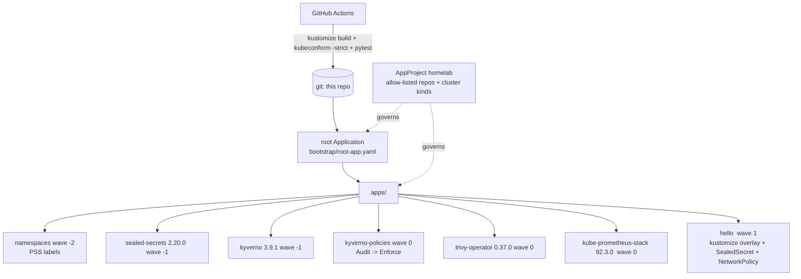

# GitOps Homelab — ArgoCD app-of-apps for a security stack, validated offline

> **Lab project.** The manifests are validated statically (kustomize + kubeconform with CRD schemas + pytest). **No cluster was created**, so ArgoCD sync and the drift demo haven't run. 

## Problem
Click-ops clusters drift. Nobody knows who disabled a policy or which chart version is running. With GitOps, git is the source of truth. One `root` Application points ArgoCD at `apps/`, and every component (Kyverno + policies, Trivy Operator, kube-prometheus-stack, Sealed Secrets, a hardened demo workload) is an Application with **pinned versions**, **selfHeal** and **sync-wave ordering**. A restricted `AppProject` limits where code may come from.

## Architecture


## Run
```bash
./scripts/validate.sh                 # needs kustomize + kubeconform
pip install pytest pyyaml && pytest -q tests     # OFFLINE=1 skips the upstream chart-version check
./scripts/drift-demo.sh               # needs docker + kind + kubectl (not run)
```
Before a real bootstrap: replace the placeholder `repoURL` (`github.com/ansarshaikh/gitops-homelab`), reseal `sealedsecret.yaml` with your controller's key, and create the `grafana-admin` secret as a SealedSecret.

## Results (actual runs, 2026-10-11, kubeconform 0.8.0, kustomize v5, K8s schema 1.33.0)
- `kubeconform -strict`: **18 resources, 18 valid, 0 invalid, 0 skipped**. That includes the ArgoCD `Application`/`AppProject`, Kyverno `ClusterPolicy` and `SealedSecret` CRDs, validated against the datreeio CRD catalog (`results/kubeconform.txt`).
- `pytest`: **10/10**. Checks: restricted project, every source allow-listed, charts pinned to exact semver, git paths build, prune+selfHeal+finalizer, sync-wave order (CRDs before their users), no plain `Secret` in git, a **negative test** (`selfheal` typo is rejected by strict schema), and a live check that **every pinned chart version exists in its upstream Helm index**.
- That last check found two real problems in my first version. Three chart versions I had written from memory were stale. The Sealed Secrets Helm repo has moved from `bitnami-labs.github.io` (now a 404) to `bitnami.github.io`.

## Limitations
- **Not run:** ArgoCD install/sync, Helm template rendering of the 4 charts (values are only checked against the Application schema, not the chart's values schema), and the drift/selfHeal demo.
- The SealedSecret contains placeholder ciphertext. It will fail to unseal until resealed.
- Single cluster and single environment. No ApplicationSet, no image-updater, no SSO/RBAC for ArgoCD itself.
- `monitoring` namespace runs PSS `privileged` (node-exporter needs host access). This is a deliberate, documented exception.

## Sources
- Argo CD app-of-apps — https://argo-cd.readthedocs.io/en/stable/operator-manual/cluster-bootstrapping/
- Sync waves — https://argo-cd.readthedocs.io/en/stable/user-guide/sync-waves/ ; AppProject — https://argo-cd.readthedocs.io/en/stable/user-guide/projects/
- kubeconform — https://github.com/yannh/kubeconform ; CRD catalog — https://github.com/datreeio/CRDs-catalog
- Sealed Secrets — https://github.com/bitnami/sealed-secrets
- Inspiration: https://github.com/acelinkio/argocd-homelab

## Related work

This is my own implementation. Ideas came from [acelinkio/argocd-homelab](https://github.com/acelinkio/argocd-homelab).
